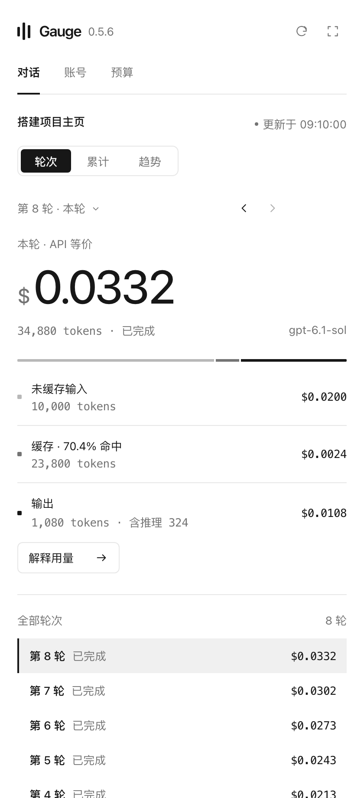
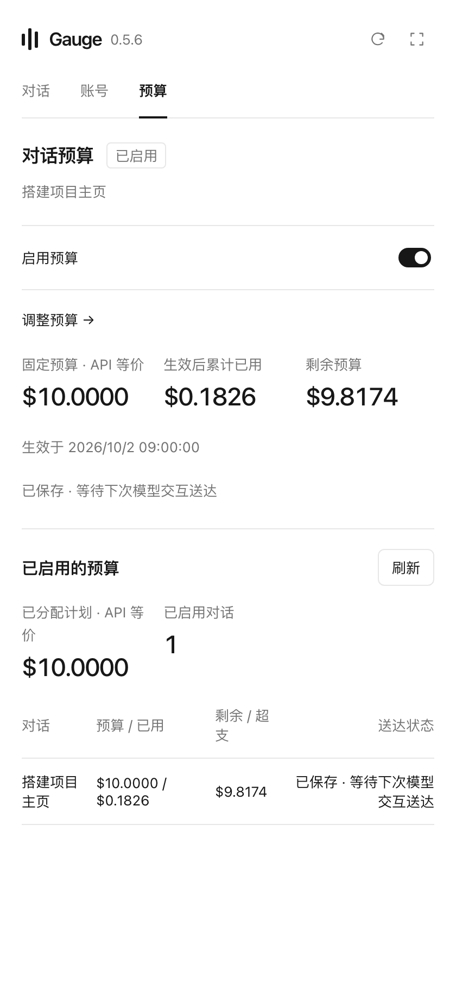
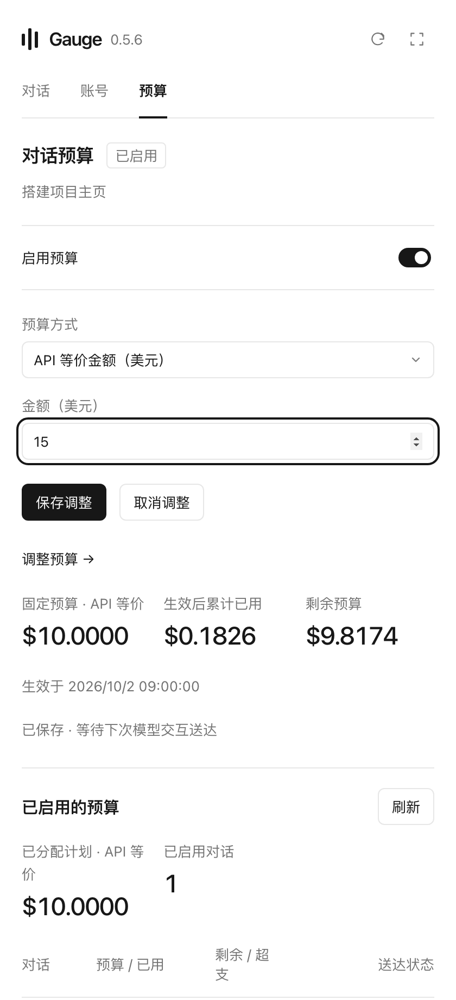

Gauge 是 **Codex Mac 桌面端的侧边栏插件**，重点展示每轮对话的 tokens 和 API 等价费用，并提供可选的对话预算。

- 每轮费用：拆分输入、缓存和输出，回看历史轮次、累计与趋势。
- 对话预算：设置金额，查看生效后已用、剩余或超支；默认关闭，按需开启。

第一次使用 Gauge，从这条指令开始：

```text
我第一次使用 Gauge，还没有下载或安装这个插件。请按以下说明帮我下载、校验并安装，确认插件已启用，再告诉我如何第一次打开：
https://raw.githubusercontent.com/DHCFE/gauge-codex-plugin/main/INSTALL.md
```

当前支持 Apple 芯片 Mac，需要已安装、能正常使用的 Codex 桌面客户端。无需 GitHub 登录、API Key 或额外开发工具。

安装完成后，新开一个聊天，说「打开 Gauge 用量面板」。新对话没有记录时显示等待状态，正常使用 Codex 后自动更新；预算默认关闭。

[完整新用户说明](https://github.com/DHCFE/gauge-codex-plugin/blob/main/INSTALL.md) · [下载最新安装包](https://github.com/DHCFE/gauge-codex-plugin/releases/latest/download/Gauge-mac-arm64.zip)

Gauge 0.5.7 修复大日志导致子代理用量漏读的问题。每轮费用、对话累计与预算共用请求解析和去重规则，支持多层子代理、跨轮复用、迟到记录和归档副本；读取未完成或归属不确定时明确显示已知部分。保留新版提醒和 macOS HTTPS 代理支持。用量金额是 API 等价估算。安装、升级、回滚和界面接线已验证；原生插件列表的更新标记及 Hook 实际模型送达尚未验证。

## 界面预览

截图使用演示数据，预算图为已开启的示例。

| 每轮费用 | 对话预算 | 预算设置 |
| --- | --- | --- |
|  |  |  |
